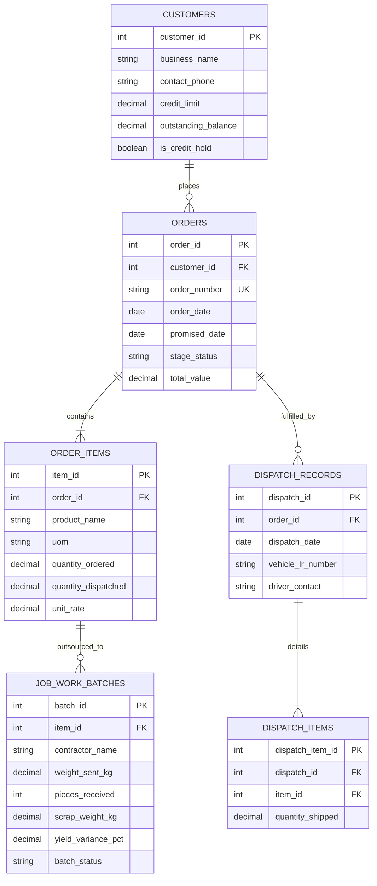
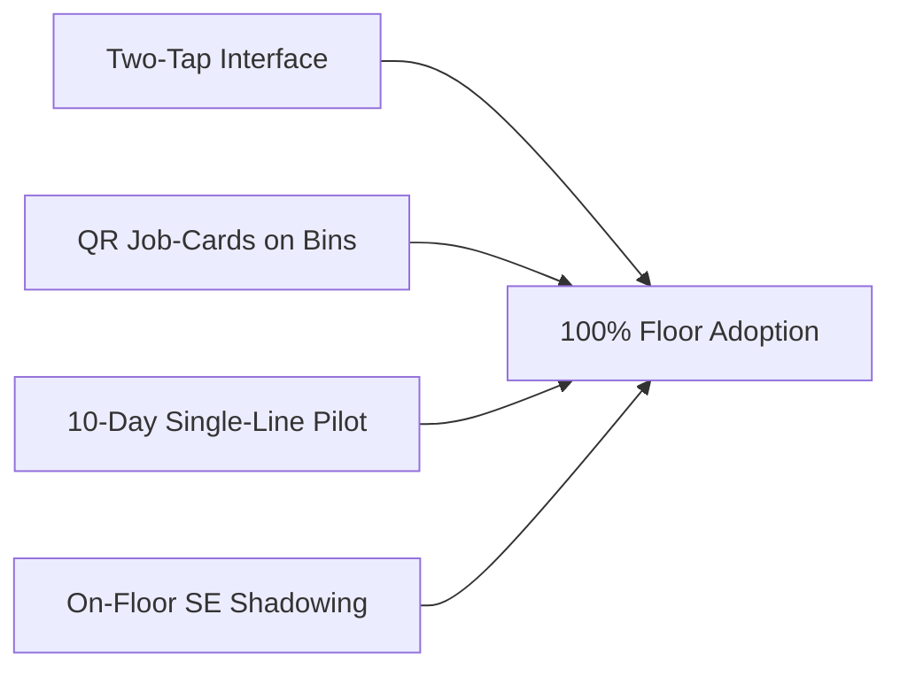

# Business Requirement Document (BRD)
## Client: Vardhan Steelware | Phase 1 Order Visibility & Fulfillment System
**Document Reference:** `WAN-SE-2026-VARDHAN-001`  
**Author:** Solutions Engineering Intern  
**Target Stakeholders:** Suresh (Promoter/Owner), Tech & Implementation Teams  
**Status:** Approved for Client Walkthrough | **Scope:** Phase 1 Minimum Viable Clarity (MVC)

---

## 1. Executive Summary & Problem Statement

Vardhan Steelware is a mid-sized stainless steel cookware manufacturer experiencing operational blindness. Despite healthy order volumes, internal execution is paralyzed by disconnected information silos across paper registers, Excel sheets, and uncoordinated WhatsApp chats. 

### Direct Stakeholder Statements & Operational Reality:
* **Suresh (Owner / Promoter):**
  > *"Main din bhar Ramesh ko phone lagake poochta rehta hoon ki kaunsa order kahan ruka hai. Mujhe apne phone pe bas itna dikh jaye ki kaunsa dispatch ke liye ready hai aur kaunsa pending."*
  * **SE Analysis:** The business promoter is operating as an ad-hoc telephone operator. Executive decision-making is throttled because there is no single-source-of-truth for order status.
* **Kunal (Order Coordinator / Next-Gen):**
  > *"We need an automated AI forecasting system, marketplace integrations, and an end-to-end ERP to compete modernly."*
  * **SE Analysis:** **The Vanity-Tech Trap.** Kunal is proposing advanced cognitive layers (AI, automated marketplace sync) on top of an unstable, corrupted data layer. Forecasting on unverified and duplicate data produces flawed projections.
* **Ramesh (Dispatch & Floor Supervisor):**
  > *"Kunal bhai order sheet mein likh dete hain par shop-floor pe raw material aur polishing contractor ke status ke bina hum exact delivery date nahi bata sakte."*
  * **SE Analysis:** Shop-floor execution is decoupled from sales commitments. The previous ERP failed because data entry was too complex for factory workers wearing gloves in an industrial environment.
* **Munshi ji (Head Accountant):**
  > *"Gaadi gate par khadi ho jaati hai tab pata chalta hai ki party ka purana payment baaki hai. Maal unload karwana padta hai."*
  * **SE Analysis:** Lack of financial gatekeeping at order booking locks up finished inventory and stalls dispatches at the exit gate.

---

## 2. Forensic Evidence Analysis & Data Inconsistencies

A forensic audit of the provided WhatsApp chat history and Order Register reveals deep structural data hygiene failures. Every finding is categorized below:

| # | Concrete Evidence Observed | Classification | Root Cause & Operational Hazard | Engineering Solution in Phase 1 |
|---|---|---|---|---|
| 1 | **Gupta Traders (200 pcs Kadai):** Appears twice in the register—once marked *Dispatched*, once marked *Pending*. | `[Reported Inconsistency]` | **Untracked Split Dispatch:** The customer likely received a partial shipment (e.g., 100 pcs). Lacking split-dispatch logic, the floor re-entered the remaining balance as a new pending row. Hazard: High risk of duplicate production run. | Implement Parent-Child Fulfillment schema (`order_item` vs `dispatch_line_item`) with auto-decrementing balance. |
| 2 | **Jain Crockery (150 pcs Kadhai):** Exact duplicate row present in order intake sheet. | `[Inferred Duplicate]` | **No Idempotency / Double Entry:** Order received via WhatsApp and entered twice by Kunal during manual reconciliation. Hazard: False demand inflating procurement. | System-enforced unique constraints: Auto-generated `Order_ID` + Customer PO idempotency validation. |
| 3 | **Order with Missing Customer Name:** Order entry containing product specifications and quantities, but customer field is `NULL`. | `[Observed Fact]` | **Hasty Manual Intake:** Details copied from an informal phone call or voice note without mandatory header validations. Hazard: Unbillable, unroutable finished goods. | Mandatory form validations on order creation: `customer_id`, `item_id`, `qty`, `uom` are non-nullable. |
| 4 | **Pending Order in "kg" without Rate:** Order line item logged with weight (e.g., `350 kg`) instead of piece count and rate left blank. | `[Observed Fact]` | **Unit of Measure (UoM) Disconnect:** Stamping/raw material is tracked in kilograms, while utensils are sold per piece. Hazard: Invoice generation blocked; inaccurate production targets. | Dual-UoM catalog in Item Master: standard piece-to-weight nominal conversion with explicit billing UoM. |
| 5 | **Sharma Order Held for Old Payment Dues:** Finished goods boxed and loaded, but halted at factory gate by Munshi ji. | `[Observed Fact]` | **Premature Production Gate:** Credit verification occurs at dispatch gate rather than order acceptance. Hazard: Working capital locked up in finished goods; floor space blocked. | "Payment Hold" workflow gate triggered immediately upon order entry if customer credit exceeds limit. |
| 6 | **Negative Quantity Row (-15 pcs):** An order line recorded with a negative integer quantity. | `[Inferred Workaround]` | **Ad-hoc Return Accounting:** Staff using forward order sheets to log customer returns or transit damage due to absence of RMA workflow. Hazard: Corrupts gross sales calculations. | Dedicated `sales_return` module with physical condition triage (Scrap vs Re-polish vs Restock). |
| 7 | **Outsourced Polishing Reconciliation:** 420 kg raw blanks sent to contractor; 1,180 finished pieces returned; 6 kg shortage flagged. | `[Needs Confirmation]` | **Theoretical vs Actual Yield Gap:** 420 kg / 1,180 pcs = 355.9 grams/pc. Without a baseline weight standard, determining whether 6 kg is allowable buffing scrap or contractor pilferage is impossible. | Job-Work Challan tracking: tracks gross weight sent, expected pieces yield, returned pieces, and scrap tolerance percentage. |

---

## 3. Business Process Mapping (As-Is vs. Proposed Phase 1)

```mermaid
flowchart TD
    subgraph As_Is [CURRENT AS-IS PROCESS: High Latency & Leakage]
        A1[Customer Phone/WhatsApp Call] --> A2[Kunal logs in Excel/Diary]
        A2 --> A3[Ramesh verbal instruction to floor]
        A3 --> A4[420kg raw blanks sent to polisher]
        A4 --> A5[1180 pcs returned - 6kg unverified loss]
        A5 --> A6[Packaging completed]
        A6 --> A7{Munshi ji checks Tally at exit gate}
        A7 -->|Old Dues Found| A8[Sharma order unloaded & held at gate]
        A7 -->|Cleared| A9[Dispatch done - partial balance entered as duplicate row]
    end

    subgraph To_Be [PROPOSED TO-BE PHASE 1: Real-Time & Traceable]
        B1[Customer Order Received] --> B2[Kunal enters Order in Central Register]
        B2 --> B3{Automated Credit Check}
        B3 -->|Overdue Dues| B4[Stage: Payment Blocked - Alert sent to Suresh/Munshi ji]
        B3 -->|Credit OK| B5[Stage: Production Scheduled - Auto QR Job Card generated]
        B5 --> B6[Ramesh: 1-Tap Outbound Job-Work Challan to Polisher]
        B6 --> B7[Polisher Return: Ramesh logs pcs & weight - Auto-calculates scrap %]
        B7 --> B8[Packaging & QC completed: Status 'Ready for Dispatch']
        B8 --> B9[Ramesh logs Dispatch: Vehicle LR & Partial qty auto-calculated]
        B9 --> B10[Suresh Phone: Instant Real-time Status without Calling Anyone]
    end
```



---

## 4. Phase 1 Scope Boundary & Explicit Exclusions

To ensure rapid rollout and 100% adoption on the shop floor, Phase 1 strictly focuses on **core operational clarity**:

### In-Scope (Phase 1 Commitments):
1. **Centralized Order Management:** Unique order IDs (`ORD-YYYY-XXXX`), automated duplicate detection, mandatory field enforcement.
2. **Shop-Floor Visual Pipeline:** 5-stage status workflow (`Order Booked` → `In Production` → `At Polishing` → `Ready for Dispatch` → `Dispatched`).
3. **Outsourced Job-Work Reconciliation:** Tracking weight sent (kg) vs. pieces returned vs. allowable scrap threshold.
4. **Fulfillment & Split-Shipment Tracking:** Parent-child dispatch structure to eliminate duplicate row workarounds.
5. **Mobile-First Role Portals:** High-contrast, minimal-click views for Suresh (executive dashboard) and Ramesh (floor dispatch logging).

### Explicit Exclusions (Deferred to Phase 2 / Phase 3):
* **AI Demand Forecasting:** *Rationale:* Machine learning models require clean, uncorrupted historical data. Implementing AI on data with duplicate entries and untracked returns produces inaccurate recommendations.
* **Full ERP / Tally Replacement:** *Rationale:* Munshi ji's accounting workflow works for compliance. Phase 1 will integrate via simple CSV/Excel dispatch summaries rather than disrupting accounting.
* **Automated E-Commerce / Marketplace Integrations:** *Rationale:* Less than 10% of Vardhan's volume is direct consumer; diverting focus to Amazon/Flipkart APIs dilutes the core B2B factory tracking fix.
* **Automated Machine Telemetry / IoT:** *Rationale:* Excessive capital expenditure and complexity for an initial digital adoption phase.

---

## 5. Relational Data Model & Production SQL Schema

### Entity-Relationship Diagram (ERD)



### Production PostgreSQL DDL Schema

```sql
-- 1. Customers Table (with credit gatekeeping)
CREATE TABLE customers (
    customer_id SERIAL PRIMARY KEY,
    business_name VARCHAR(150) NOT NULL,
    contact_phone VARCHAR(20) NOT NULL,
    credit_limit NUMERIC(12, 2) DEFAULT 0.00,
    outstanding_balance NUMERIC(12, 2) DEFAULT 0.00,
    is_credit_hold BOOLEAN DEFAULT FALSE,
    created_at TIMESTAMP WITH TIME ZONE DEFAULT CURRENT_TIMESTAMP
);

-- 2. Orders Table (central registry with unique order numbers)
CREATE TABLE orders (
    order_id SERIAL PRIMARY KEY,
    customer_id INT NOT NULL REFERENCES customers(customer_id) ON DELETE RESTRICT,
    order_number VARCHAR(50) UNIQUE NOT NULL, -- e.g. ORD-2026-0042
    order_date DATE NOT NULL DEFAULT CURRENT_DATE,
    promised_date DATE NOT NULL,
    stage_status VARCHAR(30) NOT NULL CHECK (
        stage_status IN ('ORDER_BOOKED', 'PAYMENT_HOLD', 'IN_PRODUCTION', 'AT_POLISHER', 'READY_FOR_DISPATCH', 'PARTIALLY_DISPATCHED', 'COMPLETED')
    ),
    notes TEXT,
    created_at TIMESTAMP WITH TIME ZONE DEFAULT CURRENT_TIMESTAMP
);

-- 3. Order Items Table (with rate, piece-to-weight nominal, and balance)
CREATE TABLE order_items (
    item_id SERIAL PRIMARY KEY,
    order_id INT NOT NULL REFERENCES orders(order_id) ON DELETE CASCADE,
    product_name VARCHAR(100) NOT NULL,
    uom VARCHAR(10) NOT NULL CHECK (uom IN ('PCS', 'SET', 'KG')),
    quantity_ordered NUMERIC(10, 2) NOT NULL CHECK (quantity_ordered > 0),
    quantity_dispatched NUMERIC(10, 2) DEFAULT 0.00 CHECK (quantity_dispatched >= 0),
    nominal_weight_per_pc_grams NUMERIC(8, 2), -- nominal weight for yield calculation
    unit_rate NUMERIC(10, 2) NOT NULL CHECK (unit_rate >= 0),
    CONSTRAINT chk_dispatch_not_exceed CHECK (quantity_dispatched <= quantity_ordered)
);

-- 4. Job Work Batches (external polishing reconciliation)
CREATE TABLE job_work_batches (
    batch_id SERIAL PRIMARY KEY,
    item_id INT NOT NULL REFERENCES order_items(item_id) ON DELETE RESTRICT,
    contractor_name VARCHAR(100) NOT NULL,
    weight_sent_kg NUMERIC(10, 3) NOT NULL CHECK (weight_sent_kg > 0),
    pieces_received INT DEFAULT 0 CHECK (pieces_received >= 0),
    scrap_weight_kg NUMERIC(8, 3) DEFAULT 0.000,
    batch_status VARCHAR(20) DEFAULT 'WITH_CONTRACTOR' CHECK (
        batch_status IN ('WITH_CONTRACTOR', 'RETURNED_FULL', 'DISCREPANCY_FLAGGED')
    ),
    sent_date DATE DEFAULT CURRENT_DATE,
    received_date DATE
);

-- 5. Dispatch Records & Items (tracking partial dispatches without row duplication)
CREATE TABLE dispatch_records (
    dispatch_id SERIAL PRIMARY KEY,
    order_id INT NOT NULL REFERENCES orders(order_id) ON DELETE RESTRICT,
    dispatch_date DATE NOT NULL DEFAULT CURRENT_DATE,
    vehicle_lr_number VARCHAR(50),
    dispatched_by VARCHAR(50) NOT NULL
);

CREATE TABLE dispatch_items (
    dispatch_item_id SERIAL PRIMARY KEY,
    dispatch_id INT NOT NULL REFERENCES dispatch_records(dispatch_id) ON DELETE CASCADE,
    item_id INT NOT NULL REFERENCES order_items(item_id) ON DELETE RESTRICT,
    quantity_shipped NUMERIC(10, 2) NOT NULL CHECK (quantity_shipped > 0)
);
```

---

## 6. User Roles & Access Governance Matrix

| User & Operational Persona | Device & UI Medium | Read Access Permissions | Write / Action Permissions | Core Operational Responsibility |
|---|---|---|---|---|
| **Suresh**<br>*(Owner / Promoter)* | Mobile Web App (PWA) — Clean Cards | Factory-wide visibility: pipeline stages, delay counts, held dispatches, polishing losses. | **Read-Only** with single action: Emergency PIN Override for Payment Holds. | Review morning exceptions; stop calling Ramesh 15 times a day. |
| **Kunal**<br>*(Order Coordinator)* | Desktop Browser View | All customer records, item catalog, order pipeline, dispatch history. | Create orders, update promised dates, manage customer details. | Zero incomplete rows; enforce price & UoM consistency. |
| **Ramesh**<br>*(Dispatch & Floor)* | Rugged Floor Tablet / Mobile | Queue of orders marked `IN_PRODUCTION`, `AT_POLISHER`, and `READY`. | **Two-Tap Action Buttons:** Advance stage, log Job-Work weight/pcs, log dispatch quantity & LR. | Accurate physical piece counts and vehicle loading. |
| **Munshi ji**<br>*(Accounts)* | Desktop View / CSV Export | Ledger balances, order commercial values, pending dispatch queue. | Toggle `Payment Hold` / `Credit Approved`; download daily dispatch CSV for Tally. | Stop goods from leaving the factory gate before payment clearance. |
| **Polishing Vendor** | Offline / Physical Challan | Physical paper challan with printed QR code. | No direct system access in Phase 1 (managed via Ramesh’s intake scan). | Maintain scrap losses within agreed 1.5% tolerance. |

---

## 7. Three Actionable Morning Operational Reports

All reports automatically generate and publish to Suresh's and the team's dashboard at **08:30 AM daily**.

### Report 1: The Bottleneck & Delay Tracker
* **Target Audience:** Suresh (Owner) & Ramesh (Floor Supervisor).
* **Objective:** Direct daily morning production priorities based on customer promise date.
* **SQL Query Logic:** Filter `orders WHERE stage_status NOT IN ('COMPLETED', 'PAYMENT_HOLD') AND promised_date <= CURRENT_DATE + INTERVAL '2 days' ORDER BY promised_date ASC`.
* **Report Layout:**
  | Order ID | Customer Name | Product & Order Qty | Promised Date | Current Stage | Days Overdue | Responsible Lead |
  |---|---|---|---|---|---|---|
  | `ORD-2026-0104` | Gupta Traders | Kadai 22cm (200 pcs) | 15-Oct-2026 | `AT_POLISHER` | **+2 Days** | Ramesh / Contractor |
  | `ORD-2026-0112` | Jain Crockery | Kadhai 24cm (150 pcs) | 17-Oct-2026 | `IN_PRODUCTION` | **Due Today** | Floor Foreman |

### Report 2: The Credit-Lock & Blocked Working Capital Report
* **Target Audience:** Munshi ji (Accounts) & Suresh (Owner).
* **Objective:** Clear financial blockers before finished goods occupy valuable floor space.
* **SQL Query Logic:** Filter `orders WHERE stage_status = 'PAYMENT_HOLD' ORDER BY total_value DESC`.
* **Report Layout:**
  | Order ID | Customer Name | Order Value (₹) | Outstanding Dues (₹) | Days Held | Actionable Contact |
  |---|---|---|---|---|---|
  | `ORD-2026-0098` | Sharma Utensils | ₹1,42,000 | ₹85,000 (Over 45 Days) | 4 Days | Suresh to call Promoter |

### Report 3: Outsourced Polishing Yield & Material Shrinkage Audit
* **Target Audience:** Suresh (Owner) & Ramesh (Supervisor).
* **Objective:** Detect contractor pilferage, excessive grinding losses, and unverified weight shortages.
* **Calculation:** $\text{Scrap Loss \%} = \frac{\text{Weight Sent} - (\text{Pieces Received} \times \text{Nominal Weight})}{\text{Weight Sent}} \times 100$.
* **Report Layout:**
  | Challan No | Contractor | Product | Weight Sent (kg) | Pcs Received | Expected Yield | Shortage (kg) | Scrap Variance | Status |
  |---|---|---|---|---|---|---|---|---|
  | `JW-2026-088` | R.K. Buffing Works | Kadai 20cm | 420.00 kg | 1,180 pcs | 1,200 pcs | **-6.00 kg** | **4.2%** *(Max Allowable 1.5%)* | ⚠️ Flagged for Billing Deduction |

---

## 8. Stakeholder Discovery Questions (Next Client Meeting)

### For Suresh (Commercial Authority & Scope):
1. *"Between seeing live order status on your phone and tracking material losses at polishing contractors, which one gives you immediate peace of mind in week 1?"*
2. *"What is your exact authorization threshold? Can Ramesh dispatch an order if payment is short by 5%, or does every exception require your personal PIN override?"*

### For Kunal (Order Intake & Sales Operations):
3. *"What percentage of customer orders currently arrive over WhatsApp voice notes versus formal purchase orders, and who currently validates pricing before production begins?"*
4. *"Regarding marketplace integrations: Are your Amazon/Flipkart orders fulfilled from factory stock or from an outsourced distributor warehouse?"*

### For Ramesh (Shop-Floor & Contractor Reality):
5. *"When 420 kg of Kadai blanks are sent for polishing, does the contractor sign a physical challan with weight and piece count, or is it purely verbal?"*
6. *"In your previous ERP software, what was the #1 reason the team stopped updating it after a couple of weeks?"*
7. *"Does the packing and dispatch bay have stable Wi-Fi/4G coverage for a mobile tablet, or does the floor need offline support?"*

### For Munshi ji (Financial Governance):
8. *"What is the exact credit rule? For example, if a client has ₹50,000 overdue for more than 30 days, should the system automatically prevent order confirmation or only block dispatch?"*
9. *"How do you currently handle physical returns (like the -15 pieces record in the sheet) in Tally—is it a credit note or material replacement?"*

---

## 9. Primary Project Risk & Comprehensive Mitigation Plan

### The Fatal Risk: Shop-Floor Adoption Failure (The "Previous ERP Syndrome")
Small factory digital transformations fail when software designed for air-conditioned offices is forced upon floor supervisors wearing industrial gloves in noisy, fast-paced environments. If updating an order takes more than 15 seconds, workers abandon the software and return to rough paper slips.

### The 4-Pillar Mitigation Framework:



1. **The "Two-Tap" Interface Rule:**
   * Ramesh's tablet interface features zero text inputs for routine tasks. It presents high-contrast status cards with giant buttons: `[Sent to Polisher]`, `[Received Back]`, `[Packed]`, `[Dispatched]`.
2. **Physical Barcode / QR Job Cards on Material Bins:**
   * When Kunal accepts an order, the system prints a 1-page traveler slip with a QR code attached to the wire basket. Ramesh simply scans the QR code with his camera and taps the next stage button.
3. **10-Day Controlled Pilot (Kadai Line Only):**
   * Do not roll out the system across all 80 utensil SKUs at once. Run Phase 1 exclusively on the high-volume Kadai production line for 10 working days while keeping other items on the existing process.
4. **On-Site Solutions Engineer Shadowing:**
   * The Solutions Engineer will physically shadow Ramesh on the shop floor for the first 3 days of go-live to identify and resolve immediate physical workflow friction.
