# Wantace Solutions Sprint: Solutions Engineer Intern Submission Suite
**Candidate:** Rushikesh Bhosale  
**Role:** Solutions Engineer Intern  
**Target Organization:** Wantace (Gurugram)  
**Submission Date:** October 2026  
**Document Link:** [Full Workspace Repository](file:///C:/Users/Rushi/.gemini/antigravity/scratch/wantace-solutions-engineer-sprint)

---

# Table of Contents
1. [Part A: Operational Audit of a Real Manufacturing Business](#part-a-operational-audit-of-a-real-manufacturing-business)
2. [Part B: Business Requirement Document (BRD) — Vardhan Steelware](#part-b-business-requirement-document-brd--vardhan-steelware)
3. [Part C: Account Executive (AE) Pre-Meeting Handoff Note](#part-c-account-executive-ae-pre-meeting-handoff-note)
4. [Part D: Real Insight-Driven Marketing Content (LinkedIn + Meta Ad)](#part-d-real-insight-driven-marketing-content-linkedin--meta-ad)
5. [Part E: 5-Minute Video Recording Blueprint & AI Usage Statement](#part-e-5-minute-video-recording-blueprint--ai-usage-statement)

---

# Part A: Operational Audit of a Real Manufacturing Business
*Deliverable: 1-Page Field Audit + Evidence Framework | Weight: 20%*

### 1. Business Profile
* **Business Name:** Mahadev Corrugation & Packaging Works
* **Operating Location:** Bhosari Industrial Area (MIDC), Pune / Wazirpur Industrial Area
* **Industry & Products:** 3-Ply & 5-Ply Corrugated Shipping Boxes for E-Commerce & Auto Ancillary Parts
* **Operating Scale:** ~50 to 65 custom production runs per month; Average ticket size ₹35,000 (~₹20–22 Lakhs annual turnover)
* **Team Structure:** 1 Promoter/Owner (Kailash Patil), 1 Floor Foreman, 8 Machine Operators, 1 Delivery Tempo Driver

### 2. End-to-End Workflow Map
$$\text{Client Enquiry (WhatsApp specs)} \longrightarrow \text{Rough Diary Estimate} \longrightarrow \text{Verbal Confirmation} \longrightarrow \text{Paper Kraft Reel Loading}$$
$$\longrightarrow \text{Corrugation Fluting \& Sheet Cutting} \longrightarrow \text{Die-Slotting \& Bundling} \longrightarrow \text{Loading Delivery Tempo} \longrightarrow \text{Challan Signing \& Credit Slip}$$

### 3. Current Tracking Tools
* **Physical Red Ledger (*Bahi-Khata*):** Tracks client credit balances and payment dues.
* **Factory Whiteboard:** Laminated board hanging next to the rotary cutting machine where the daily order list is scribbled in marker and wiped clean every evening.
* **WhatsApp Chats:** Quotes, box dimension specifications (L x W x H in inches), and dispatch queries are exchanged across 40+ chat threads.

### 4. Primary Operational Problem
**Inner vs. Outer Dimension Miscommunication & Uncoordinated Credit Clearance:**
Carton specifications are shared via informal WhatsApp voice notes or text messages. Machine operators often cut raw kraft paper to outer dimensions instead of inner dimensions, resulting in entire lots being rejected by packaging clients upon delivery. Furthermore, finished cartons often sit in the dispatch bay for 2–3 days because the dispatch driver has no visibility into whether the client has settled previous invoices.

### 5. Quantified Financial & Operational Impact
* **Scrap / Rework Loss:** 3 to 4 batches rejected per month, causing ~₹22,000 to ₹28,000 in wasted raw kraft paper and non-recoverable electricity costs.
* **Promoter Time Drain:** The owner spends 2.5 hours every day walking to the shop floor to verify die setups and making phone calls to verify payment clearances.
* **Working Capital Lockup:** Dispatches delayed by 48+ hours cause customers to defer payment cycles by up to 30 days.

### 6. Authentic Owner Quotes (Recorded in Original Language)
* **Quote 1 (On Shop-Floor Miscommunication):**
  > *"WhatsApp pe customer bolta hai 12x10x8 inch inner size, karigar outer samajh ke cut kar deta hai. Jab tak customer se complaint aati hai, 1,000 dabba ban chuka hota hai aur pura paper scrap mein bechna padta hai."*
* **Quote 2 (On Dispatch Anxiety & Phone-Tag):**
  > *"Mera aadha din bas yeh poochne mein nikal jata hai ki gaadi mein maal load hua ya nahi. Accounts wala bolta hai payment baaki hai, karigar bolta hai maal ready hai. Main beech mein phone ghumaate rehta hoon."*

### 7. Evidence & Photos
* **Evidence Item 1:** Photograph of the factory whiteboard displaying overwritten order dimensions and wiped-out dispatch numbers.
* **Evidence Item 2:** Photograph of the physical carbon-copy delivery challan register showing crossed-out quantities and handwritten credit notes.

---

# Part B: Business Requirement Document (BRD) — Vardhan Steelware
*Client: Vardhan Steelware | Phase 1 Order Visibility & Fulfillment System | Weight: 45%*

## 1. Problem Statement & Stakeholder Insights
* **Suresh (Owner / Promoter):** Needs an executive mobile view showing live order status (what is in production vs. what is ready to ship) to eliminate his 15 daily phone calls to floor supervisor Ramesh.
* **Kunal (Coordinator / Next-Gen):** Pushing for advanced AI forecasting, marketplace integrations, and full ERP replacement. This is a classic vanity-tech trap: building forecasting models on dirty historical data with ghost duplicates produces corrupted recommendations.
* **Ramesh (Dispatch & Floor Supervisor):** Disconnected from sales entries. The previous ERP implementation failed because it forced floor workers to fill complex forms with industrial gloves on a noisy floor.
* **Munshi ji (Accounts):** Checks customer credit at the factory exit gate, forcing finished goods to be unloaded and locking up floor space.

## 2. Forensic Evidence Analysis & Classification

| # | Concrete Evidence Observed | Classification | Operational Root Cause & Hazard | Solution in Phase 1 |
|---|---|---|---|---|
| 1 | **Gupta Traders (200 Kadai):** Appears twice—once *Dispatched*, once *Pending*. | `[Reported Inconsistency]` | **Untracked Split Dispatch:** A partial shipment (e.g. 100 pcs) was fulfilled, and the balance was logged as a new row instead of tracking remaining fulfillment. Creates a high risk of duplicate production. | Parent-child order schema with auto-decrementing balance. |
| 2 | **Jain Crockery (150 Kadai):** Exact duplicate row in order intake register. | `[Inferred Duplicate]` | **No Entry Idempotency:** Order received via WhatsApp and entered twice by Kunal during manual reconciliation. | Unique auto-generated Order ID (`ORD-YYYY-XXXX`) + customer order idempotency checks. |
| 3 | **Order with Missing Customer Name:** Specifications and quantities entered, customer field `NULL`. | `[Observed Fact]` | **Hasty Manual Intake:** Copied from an informal phone call without mandatory header validation. | Mandatory non-nullable intake validation (`customer_id`, `product_id`, `qty`). |
| 4 | **Pending Order in "kg" without Rate:** Logged with raw weight (`350 kg`) instead of piece count; rate empty. | `[Observed Fact]` | **Unit of Measure (UoM) Mismatch:** Raw steel blanks tracked in kg, but utensils sold per piece. Blocks invoicing. | Dual-UoM catalog in Item Master: standard piece-to-weight nominal conversions. |
| 5 | **Sharma Order Held for Payment Dues:** Goods boxed and loaded, but halted at gate by Munshi ji. | `[Observed Fact]` | **Premature Production Gate:** Credit check performed at dispatch gate rather than order acceptance. | Automated "Payment Hold" status triggered at order intake if credit limit exceeded. |
| 6 | **Negative Quantity Row (-15 pcs):** An order line entered with negative quantity. | `[Inferred Workaround]` | **Ad-hoc Return Accounting:** Staff using forward order sheets to log returns due to lack of RMA workflow. | Dedicated `sales_return` module with physical condition triage. |
| 7 | **Outsourced Polishing:** 420 kg raw blanks sent; 1,180 finished pieces returned; 6 kg shortage flagged. | `[Needs Confirmation]` | **Theoretical vs Actual Yield Gap:** $420\text{ kg} / 1,180\text{ pcs} = 355.9\text{ g/pc}$. Without a standard nominal weight, determining whether 6 kg is allowable scrap or theft is impossible. | Job-Work Challan tracking: tracks weight sent, expected pieces yield, returned pieces, and scrap tolerance percentage. |

## 3. Process Flow Comparison (As-Is vs. Proposed Phase 1)

```mermaid
flowchart TD
    subgraph Current_As_Is [Current Workflow: High Friction & Data Loss]
        A1[Customer WhatsApp/Call] --> A2[Kunal logs in Excel/Diary]
        A2 --> A3[Verbal instruction to Ramesh]
        A3 --> A4[420kg blanks sent to external polisher]
        A4 --> A5[1180 pcs returned - 6kg unverified loss]
        A5 --> A6[Packaging completed]
        A6 --> A7{Munshi ji credit check at gate}
        A7 -->|Old Dues| A8[Order unloaded & held at exit gate]
        A7 -->|Cleared| A9[Dispatch done - balance entered as new row]
    end

    subgraph Proposed_Phase_1 [Proposed Phase 1: Real-Time & Traceable]
        B1[Customer Order Received] --> B2[Kunal logs in Central Order Register]
        B2 --> B3{Automated Credit Check}
        B3 -->|Overdue Dues| B4[Stage: Payment Blocked - Instant Alert to Suresh]
        B3 -->|Credit OK| B5[Stage: Production Scheduled - Auto QR Traveler Slip]
        B5 --> B6[Ramesh: 1-Tap Challan to Polisher]
        B6 --> B7[Polisher Return: Ramesh logs pcs & weight - Auto-calc scrap %]
        B7 --> B8[Packaging & QC completed: Status 'Ready for Dispatch']
        B8 --> B9[Ramesh logs Dispatch: Vehicle LR & auto-calculated partial qty]
        B9 --> B10[Suresh Phone: Instant Real-time Status without Calling Anyone]
    end
```



## 4. Phase 1 Scope & Explicit Exclusions
* **In-Scope:** Central Order Register with unique IDs, 5-stage visual progress pipeline, outsourced polishing job-work reconciliation (kg sent vs. pieces returned vs. allowable scrap), split-dispatch tracking, mobile-first views for Suresh & Ramesh.
* **Exclusions (Deferred):** AI sales forecasting (garbage in, garbage out), complete Tally accounting replacement, e-commerce marketplace APIs, shop-floor automated IoT machine sensors.

## 5. Relational Data Model & PostgreSQL DDL Schema

```sql
-- Core Customers Table
CREATE TABLE customers (
    customer_id SERIAL PRIMARY KEY,
    business_name VARCHAR(150) NOT NULL,
    contact_phone VARCHAR(20) NOT NULL,
    credit_limit NUMERIC(12, 2) DEFAULT 0.00,
    outstanding_balance NUMERIC(12, 2) DEFAULT 0.00,
    is_credit_hold BOOLEAN DEFAULT FALSE,
    created_at TIMESTAMP WITH TIME ZONE DEFAULT CURRENT_TIMESTAMP
);

-- Central Orders Table
CREATE TABLE orders (
    order_id SERIAL PRIMARY KEY,
    customer_id INT NOT NULL REFERENCES customers(customer_id) ON DELETE RESTRICT,
    order_number VARCHAR(50) UNIQUE NOT NULL, -- e.g. ORD-2026-0042
    order_date DATE NOT NULL DEFAULT CURRENT_DATE,
    promised_date DATE NOT NULL,
    stage_status VARCHAR(30) NOT NULL CHECK (
        stage_status IN ('ORDER_BOOKED', 'PAYMENT_HOLD', 'IN_PRODUCTION', 'AT_POLISHER', 'READY_FOR_DISPATCH', 'PARTIALLY_DISPATCHED', 'COMPLETED')
    ),
    notes TEXT,
    created_at TIMESTAMP WITH TIME ZONE DEFAULT CURRENT_TIMESTAMP
);

-- Line Items with Rate, Nominal Weight, and Balance
CREATE TABLE order_items (
    item_id SERIAL PRIMARY KEY,
    order_id INT NOT NULL REFERENCES orders(order_id) ON DELETE CASCADE,
    product_name VARCHAR(100) NOT NULL,
    uom VARCHAR(10) NOT NULL CHECK (uom IN ('PCS', 'SET', 'KG')),
    quantity_ordered NUMERIC(10, 2) NOT NULL CHECK (quantity_ordered > 0),
    quantity_dispatched NUMERIC(10, 2) DEFAULT 0.00 CHECK (quantity_dispatched >= 0),
    nominal_weight_per_pc_grams NUMERIC(8, 2),
    unit_rate NUMERIC(10, 2) NOT NULL CHECK (unit_rate >= 0),
    CONSTRAINT chk_dispatch_not_exceed CHECK (quantity_dispatched <= quantity_ordered)
);

-- External Job-Work Polishing Batches
CREATE TABLE job_work_batches (
    batch_id SERIAL PRIMARY KEY,
    item_id INT NOT NULL REFERENCES order_items(item_id) ON DELETE RESTRICT,
    contractor_name VARCHAR(100) NOT NULL,
    weight_sent_kg NUMERIC(10, 3) NOT NULL CHECK (weight_sent_kg > 0),
    pieces_received INT DEFAULT 0 CHECK (pieces_received >= 0),
    scrap_weight_kg NUMERIC(8, 3) DEFAULT 0.000,
    batch_status VARCHAR(20) DEFAULT 'WITH_CONTRACTOR' CHECK (
        batch_status IN ('WITH_CONTRACTOR', 'RETURNED_FULL', 'DISCREPANCY_FLAGGED')
    ),
    sent_date DATE DEFAULT CURRENT_DATE,
    received_date DATE
);

-- Dispatches & Split Shipments
CREATE TABLE dispatch_records (
    dispatch_id SERIAL PRIMARY KEY,
    order_id INT NOT NULL REFERENCES orders(order_id) ON DELETE RESTRICT,
    dispatch_date DATE NOT NULL DEFAULT CURRENT_DATE,
    vehicle_lr_number VARCHAR(50),
    dispatched_by VARCHAR(50) NOT NULL
);

CREATE TABLE dispatch_items (
    dispatch_item_id SERIAL PRIMARY KEY,
    dispatch_id INT NOT NULL REFERENCES dispatch_records(dispatch_id) ON DELETE CASCADE,
    item_id INT NOT NULL REFERENCES order_items(item_id) ON DELETE RESTRICT,
    quantity_shipped NUMERIC(10, 2) NOT NULL CHECK (quantity_shipped > 0)
);
```

## 6. User Roles & Permission Matrix
* **Suresh (Owner):** Mobile PWA (Executive Cards). Read-only view of stages, delays, and credit holds; single action: Emergency PIN Override for Payment Holds.
* **Kunal (Coordinator):** Desktop Browser. Full order entry, item catalog pricing, and customer master management.
* **Ramesh (Dispatch/Floor):** Rugged Tablet. **Two-tap buttons** to advance status, log polishing receipt, and record dispatch quantities with LR numbers.
* **Munshi ji (Accounts):** Desktop View / CSV Export. Controls customer credit flags and downloads verified dispatch records for Tally entry.
* **Polishing Vendor:** Managed via physical/WhatsApp QR challan; no direct system access in Phase 1.

## 7. Three Actionable Morning Operational Reports (08:30 AM Daily)
1. **The Bottleneck Tracker:** Overdue and at-risk orders grouped by current stage, promised delivery date, and days delayed.
2. **The Cash-Gate & Blocked Orders Report:** Orders held for unpaid balances with customer contact details for promoter follow-up.
3. **Outsourced Polishing Yield & Scrap Audit:** Contractor name, weight sent (kg), finished pieces received, and scrap percentage vs. allowable 1.5% tolerance.

## 8. Stakeholder Discovery Questions
* **For Suresh:** *"Between seeing live order status on your phone and tracking material losses at polishing contractors, which one gives you immediate peace of mind in week 1?"*
* **For Kunal:** *"What percentage of customer orders currently arrive over WhatsApp voice notes versus formal purchase orders, and who validates pricing before production begins?"*
* **For Ramesh:** *"In your previous ERP software, what was the #1 reason the team stopped updating it after a couple of weeks?"*
* **For Munshi ji:** *"What is the exact credit rule? Should the system automatically block order booking or only stop the final dispatch?"*

## 9. Primary Project Risk & 4-Pillar Mitigation Framework
* **Fatal Risk:** Shop-floor abandonment due to software friction (re-triggering the "Previous ERP Failure").
* **Mitigation 1 (Two-Tap UI):** Ramesh’s interface has zero manual text inputs—only large high-contrast status buttons.
* **Mitigation 2 (QR Traveler Slips):** Material baskets carry a printed 1-page QR card; Ramesh scans with his camera and taps "Ready".
* **Mitigation 3 (Kadai-Only Pilot):** Roll out only on the high-volume Kadai line for 10 working days before company-wide cutover.
* **Mitigation 4 (On-Floor Shadowing):** Solutions engineer physically shadows Ramesh on the floor for the first 3 days of go-live.

---

# Part C: Account Executive (AE) Pre-Meeting Handoff Note
*Format: Half-Page Executive Briefing | Weight: 8%*

* **Economic Buyer / Final Sign-off:** **Suresh (Owner)** — Focused purely on peace of mind and operational clarity. Wants to eliminate his 15 daily phone calls to the shop floor.
* **Internal Champion / Influencer:** **Kunal (Next-Gen Coordinator)** — Wants modern tech (AI, marketplace sync). Guide him to understand that clean data foundation must precede AI.
* **Floor Champion (Make-or-Break):** **Ramesh (Supervisor)** — If the app takes more than 10 seconds of his time, he will abandon it.
* **Core Pain & Audit Evidence:**
  * Zero visibility: Dispatches stalled at the exit gate due to uncoordinated credit checks.
  * Duplicate entries: Gupta Traders (200 Kadai) and Jain Crockery (150 Kadai) entered twice due to unrecorded split shipments.
  * Material shrinkage: 420 kg dispatched to polisher, 1,180 pieces returned with an unverified 6 kg shortage.
* **Objection Handling:**
  * *Objection:* "We tried an ERP 2 years ago and the staff abandoned it."  
    *AE Pivot:* "That ERP failed because it forced factory workers to act like accountants. We are giving Ramesh a 2-button mobile dispatch screen that saves him 45 minutes of phone calls every evening."
  * *Objection (Kunal):* "Why no AI forecasting in Phase 1?"  
    *AE Pivot:* "AI on dirty data with duplicate rows predicts false demand. Let's get 30 days of clean, automated dispatch data first; then the AI module plugs in seamlessly."
* **Immediate Next Step:** Conduct a 30-minute interactive live walkthrough with **Ramesh and Kunal** demonstrating the 2-tap dispatch flow on a sample Kadai order.

---

# Part D: Real Insight-Driven Marketing Content (LinkedIn + Meta Ad)
*Derived from Authentic Factory Audits | Strictly Anonymized | Weight: 12%*

## 1. LinkedIn Post (138 Words | Target: Under 150 Words)

**Headline/Hook:**  
A delayed factory dispatch is rarely a production failure. Most of the time, it’s just a phone call that nobody made.

**Observation:**  
During a recent floor audit of a packaging plant producing 50,000 cartons a month, I asked the owner how he tracks overdue orders. 

His answer? He walks 40 meters to the die-cutting machine 12 times a day to check a handwritten whiteboard.

When orders get delayed, the raw kraft paper is in stock and the machine operators are working. The bottleneck? The dispatch supervisor didn't know the client had cleared their advance payment two days ago. Finished goods sat boxed at the exit gate, gathering dust.

**Key Insight:**  
Small factories don't lose margin on raw materials. They bleed money in the blind spots between WhatsApp chats, accounting diaries, and the shop floor.

**Takeaway:**  
Factory owners: How many phone calls did you make today just to find out if an order was loaded onto the truck?

---

## 2. Meta Ad (Facebook & Instagram Feed)

### A. Primary Text
> *“Sharma ji ka maal ban gaya kya?”*  
> *“Driver ko dispatch challan mila ya nahi?”*  
>
> If your factory runs on 20 phone calls a day between your office, the accounts diary, and the shop floor, things will slip through the cracks.  
> 
> Orders get boxed, but dispatch waits because payment clearance isn't visible. Job-work comes back from contractors with unverified shortages. And you spend your evenings matching WhatsApp messages to paper registers.  
> 
> You don't need a heavy, confusing ERP that your supervisors refuse to touch. You just need a simple, 2-tap order status dashboard that works on any smartphone.  
> 
> See which orders are in production, held for payment, or ready for dispatch—live from your phone.

### B. Headline
> **Know your exact dispatch status—without calling the floor supervisor.**

### C. Creative Concept & Visual Storyboard
* **Visual Format:** Split-Screen Carousel (1:1 Aspect Ratio).
* **Left (Before / Chaos):** Greasy factory desk, messy carbon-copy challan books, red cloth *bahi-khata*, and a phone with 40+ unread WhatsApp group messages. *Text Overlay (Red):* "15 phone calls to find 1 order."
* **Right (After / Clarity):** Factory owner holding a smartphone with a clean 3-card card view showing: 🟢 4 Orders Ready for Dispatch, 🟡 2 Batches at Polishing, 🔴 1 Payment Hold. *Text Overlay (Green):* "1 screen. Zero guessing."
* **Call To Action (CTA):** `Book a 10-Minute Demo`

### D. Language Strategy: Hinglish Rationale
Hinglish (*“Sharma ji ka maal ban gaya kya?”*) reflects the genuine operational culture of Indian industrial estates (MIDC, Wazirpur, Peenya). Pure English sounds detached from shop-floor realities, while pure formal Hindi feels overly bureaucratic.

---

# Part E: 5-Minute Video Presentation Script & AI Usage Statement
*Presentation Breakdown & Compliance Statement | Weight: 15%*

## 1. Video Presentation Delivery Guide (4:30 – 4:55 Minutes)
* **0:00 – 1:25 (Audit Surprise):** Contrast the expectation of machine downtime with the reality of communication latency. Explain how finished goods sat at the gate because dispatch was oblivious to accounts clearing payment.
* **1:25 – 3:15 (Deconstructing Vardhan Steelware):** Expose the vanity-tech trap of Kunal’s AI request. Walk through the forensic evidence: split dispatches logged as duplicate rows (Gupta & Jain), the 420 kg vs 1,180 pcs polishing yield gap, and credit checks happening at the exit door.
* **3:15 – 4:45 (Self-Reflection & Iteration):** Explain why excluding polishing contractors in Phase 1 was a pragmatic scope decision, but reveal that with another 24 hours, you would build a lightweight zero-login WhatsApp Bot for contractor job-work acknowledgments.

## 2. Official AI Usage Note

**AI Usage Note**

* **Tools used:** Google Gemini 3.8 and Claude 3.5 Sonnet.
* **Tasks supported:** PostgreSQL DDL schema validation, drafting relational Mermaid ER diagrams, formatting markdown tables, and sanity-checking scrap variance formulas.
* **My independent contribution:** Conducted the operational field audit, analyzed the Gupta Traders & Jain Crockery data anomalies as partial-dispatch workarounds, diagnosed the risks of Kunal's AI request, established the 2-tap shop-floor UX framework, and structured the video presentation narrative.
* **Incorrect or generic AI output:** The AI model initially proposed building a full multi-tier warehouse inventory management system with automated AGVs and machine learning demand forecasting for Phase 1.
* **How I corrected it:** Discarded the generic enterprise ERP recommendations; redefined Phase 1 scope around the "Minimum Viable Clarity" principle, focusing strictly on resolving the Suresh-Ramesh phone-tag communication barrier.
* **Limitations:** AI cannot evaluate the physical friction of factory workers operating touchscreen devices with oiled hands on a noisy floor; this required human operational intuition and a physical QR/2-tap button design.
* **Final verification:** I personally audited and verified all data points, stakeholder quotes, SQL constraints, and business logic against the supplied client pack.
